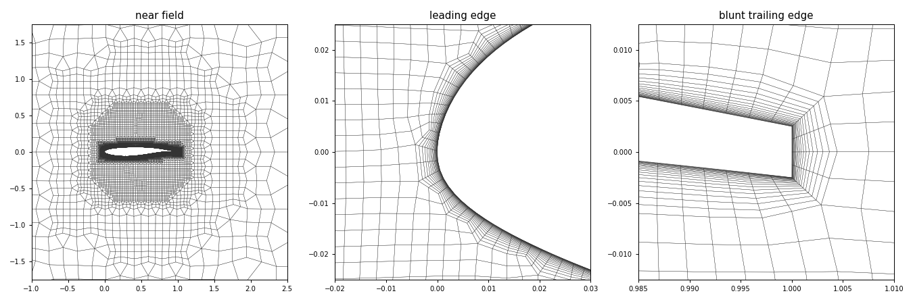

# Boundary-layer meshes with cfMesh

Viscous simulations of airfoils require meshes with thin cells at the wall that resolve
the boundary layer. Trixi.jl reads unstructured quadrilateral meshes for its
[`P4estMesh`](@extref Trixi.P4estMesh) from Abaqus `.inp` files, where the boundaries are
given as node sets (see also the Trixi.jl tutorial
["P4estMesh from gmsh"](https://trixi-framework.github.io/TrixiDocumentation/stable/tutorials/p4est_from_gmsh/)).
This page describes how to generate such a mesh with boundary layers using the octree
mesher [cfMesh](https://cfmesh.com) for the ONERA OAT 15A supercritical airfoil, which is
used in the example `p4est_2d_dgsem/elixir_navierstokes_OAT15Aairfoil.jl`. All scripts
and settings are contained in the directory
[`utils/cfmesh`](https://github.com/ACoM-RWTH/AeroTrixi.jl/tree/main/utils/cfmesh) of
AeroTrixi.jl.

[](assets/cfmesh_oat15a_mesh.png)

The mesh consists of 35368 straight-sided quadrilaterals in a circular domain with a
radius of 50 chord lengths. At the airfoil, the cells have a size of 0.003125 chord
lengths along the surface and 20 boundary layers with a growth ratio of 1.2, with a first
layer height of about ``2.5 \cdot 10^{-5}`` chord lengths (between ``1.4 \cdot 10^{-5}``
and ``3.2 \cdot 10^{-5}``); at the far field, the cells have a size of 6.4 chord lengths.

!!! warning "The first layer height cannot be prescribed"
    With the command-line tools of cfMesh, neither the height of the first boundary layer
    nor the total thickness of the layers can be set directly. The first layer height is a
    *result* of the cell size at the wall, the number of layers, and their growth ratio,
    see [Step 3](@ref cfmesh_step3) below. To obtain a desired first layer height (or
    ``y^+``), adjust these parameters and check the first layer height reported by
    `polymesh_to_inp.py`.

## Running the example

The example simulates the transonic flow around the OAT 15A airfoil at the conditions of
the buffet experiment of
[Jacquin et al. (2009)](https://doi.org/10.2514/1.30190), i.e., a Mach number of 0.73,
an angle of attack of 3.5 degrees, and a Reynolds number of ``3 \cdot 10^6``, see also the
numerical study of [Deck (2005)](https://doi.org/10.2514/1.9885). Since Trixi.jl does not
provide a turbulence model, the compressible Navier-Stokes equations are solved for a
laminar flow, i.e., the example demonstrates the setup of such a simulation rather than a
validated buffet prediction. Besides the lift and drag coefficients, the example saves the
pointwise pressure and friction coefficients on the airfoil with the
[`SurfacePointwiseCallback`](@ref). A short run is started with
```julia
using Trixi, AeroTrixi
trixi_include(joinpath(examples_dir(), "p4est_2d_dgsem",
                       "elixir_navierstokes_OAT15Aairfoil.jl"),
              tspan = (0.0, 1e-4))
```

## Overview of the workflow

The driver script `utils/cfmesh/Allmesh` runs all steps in a separate case directory:
```bash
cd utils/cfmesh
CFMESH_BIN=/path/to/cfMesh/bin ./Allmesh out_oat15a
```
This creates the mesh `out_oat15a/oat15a_airfoil.inp` within a few seconds. Besides the
cfMesh command-line tools `surfaceFeatureEdges` and `cartesian2DMesh` (tested with
CF-MESH+ 5.4), Python 3 with NumPy and SciPy is required. The steps are:

1. `generate_geometry.py`: the airfoil and the far-field boundary as a surface mesh (STL),
2. `surfaceFeatureEdges`: conversion to the native cfMesh format `.fms` with feature edges,
3. `cartesian2DMesh`: generation of a 2D base mesh with boundary layers, controlled by
   `system/meshDict`,
4. `polymesh_to_inp.py`: conversion to conforming quadrilaterals in the Abaqus format,
5. optionally `inp_to_msh.py`: conversion to the Gmsh format for inspection.

These steps are explained in the following.

## Step 1: geometry

The 2D mesher `cartesian2DMesh` of cfMesh expects the geometry as a "ribbon", i.e., the
boundary curves in the ``x``-``y`` plane extruded in the ``z`` direction, without surface
elements whose normals have a ``z`` component. `generate_geometry.py` reads the 300 tabulated
coordinates of the OAT 15A airfoil (`oat15a_coordinates_c015.dat`, given for a chord length
of 0.15 and rescaled to a unit chord with the leading edge at the origin), interpolates
them with a cubic spline, and resamples the spline with points clustered towards the
leading and trailing edges. The blunt trailing edge (thickness of 0.005 chord lengths) is
closed by a straight segment. Together with a circle with a radius of 50 chord lengths
around the leading edge, both curves are extruded and written as an ASCII STL file with
one solid per boundary:
```
solid airfoil
  facet normal ...
  ...
endsolid airfoil
solid farfield
  ...
endsolid farfield
```
The names of the solids become the names of the boundary patches and, eventually, of the
node sets in the `.inp` file. The facet normals point out of the fluid domain.

## Step 2: feature edges

```bash
surfaceFeatureEdges -angle 30 oat15a_airfoil.stl oat15a_airfoil.fms
```
converts the STL file to the native `.fms` format of cfMesh and marks all edges with an
angle larger than 30 degrees between the adjacent facets as feature edges. This ensures
that the two sharp corners of the blunt trailing edge are preserved in the mesh.

## [Step 3: base mesh with boundary layers](@id cfmesh_step3)

cfMesh is an octree mesher: starting from a coarse cell size `maxCellSize`, the cells are
refined by halving, i.e., all cell sizes are `maxCellSize / 2^n`. The cells at the
boundary are then projected onto the geometry, and boundary layers are extruded from the
boundary towards the interior. The settings are provided in `system/meshDict`; the most
important ones for the airfoil are
```c++
surfaceFile     "oat15a_airfoil.fms";

maxCellSize     12.8;

localRefinement
{
    airfoil
    {
        additionalRefinementLevels 11;  // 12.8 / 2^11 = 0.00625
        refinementThickness 0.04;
    }
}

objectRefinements
{
    nearBody
    {
        type        sphere;
        centre      (0.5 0 0);
        radius      0.75;
        additionalRefinementLevels 8;   // 0.05
    }
    // ... further spheres with radii 1.5, 4.5, 10.5
}

boundaryLayers
{
    patchBoundaryLayers
    {
        airfoil
        {
            nLayers                 10;     // -> 20 layers after splitting
            thicknessRatio          1.44;   // -> 1.2 after splitting
            allowDiscontinuity      0;
        }
    }
}
```
The nested spheres (circles in the ``x``-``y`` plane) around mid-chord let the cell size
grow approximately linearly with the distance to the airfoil, since the 2:1 balance of the
octree alone would coarsen the cells too quickly. The cell sizes are given as numbers of
refinement levels; prescribing a `cellSize` that is an exact power of two of `maxCellSize`
resulted in one more refinement level than requested.

All sizes are twice the target sizes, since the cells are split once in step 4. For the
same reason, the 10 layers with a growth ratio of 1.44 of the base mesh become 20 layers
with a growth ratio of ``\sqrt{1.44} = 1.2`` in the final mesh.

A few properties of cfMesh are important for the boundary layers:

- The layers are created by inserting one layer of cells at the boundary, whose thickness
  ``T`` is approximately the local cell size, and by splitting this layer into
  ``n`` = `nLayers` layers with the growth ratio ``r`` = `thicknessRatio`. The total
  thickness of the layers is therefore determined by the cell size at the wall (here
  ``T \approx 0.0046`` chord lengths), and the first layer height follows as
  ```math
  h_1 = T \frac{r - 1}{r^n - 1},
  ```
  i.e., **the first layer height cannot be prescribed**, but only be influenced via
  ``n``, ``r``, and the cell size at the wall. For the base mesh, ``n = 10`` and
  ``r = 1.44`` give ``h_1 \approx 5.4 \cdot 10^{-5}``, which becomes
  ``h_1 \approx 2.5 \cdot 10^{-5}`` after the splitting in step 4. The jump of the cell
  height from the last layer to the adjacent cell is roughly ``r / (r - 1)`` for many
  layers, i.e., large growth ratios give smoother transitions.
- The keywords `firstLayerThickness`, `totalLayerThickness`, `nOuterLayers`,
  `desiredYPlus`, and `inletOutletPatches` of the CF-MESH+ manual are not supported by the
  command-line tools and are silently ignored. The supported keyword
  `maxFirstLayerThickness` keeps the growth ratio for the inner layers and puts the
  remaining thickness into the last layer, which results in a large jump of the cell
  height within the layers.
- `cartesian2DMesh` creates the empty patches `bottomEmptyFaces` and `topEmptyFaces` for
  the two ``z`` planes. They cannot be renamed, and setting `defaultName`/`defaultType`
  in the `renameBoundary` dictionary would turn them into walls.
- cfMesh runs multi-threaded with OpenMP, and multi-threaded runs produce valid but
  differently numbered meshes. `Allmesh` therefore sets `OMP_NUM_THREADS=1` (unless set
  otherwise), which makes the mesh reproducible.

The base mesh is written in the OpenFOAM format `constant/polyMesh`. `check_mesh.py`
reports its cell types, validity, non-orthogonality, and the heights of the boundary
layers, as a substitute for OpenFOAM's `checkMesh`.

## Step 4: conversion to conforming quadrilaterals

At the transitions between refinement levels, the octree mesh contains hanging nodes:
a coarse cell has an additional node on one edge, where two smaller cells meet, and is
therefore stored as a pentagon (or hexagon) in the OpenFOAM format. The `P4estMesh`,
however, requires a conforming quadrilateral mesh. Therefore,
```bash
python3 polymesh_to_inp.py out_oat15a out_oat15a/oat15a_airfoil.inp 10 1.44
```
splits every cell with ``m`` edges into ``m`` quadrilaterals, using one new node on each
edge and one new node in the cell. Since each edge is split exactly once, neighboring
cells remain conforming, and all cells become quadrilaterals. The arguments `12` and
`1.44` are the number of layers and the growth ratio of the base mesh; `Allmesh` reads
them from `system/meshDict`. The details are:

- The edges of the layer cells normal to the wall are split at the fraction
  ``1/(1 + \sqrt{r})`` from the wall side, which results in a geometric sequence of the
  layer heights with ratio ``\sqrt{r}``. All other edges are split at their midpoints.
- The new nodes on the boundary are moved from the straight edges onto the exact geometry,
  i.e., the airfoil spline and the far-field circle. At the airfoil, this displacement is
  blended out linearly over the layers, so that the thin cells at the wall are shifted
  instead of being compressed or inverted.
- The new nodes inside the cells are placed by transfinite interpolation of the four edge
  nodes.

The script reports the quality of the resulting mesh, for instance
```
after splitting: 20 layers with ratio 1.2, first layer height min 1.41e-05, median 2.46e-05, max 3.16e-05; total layer thickness median 4.60e-03
...
quads: 35368, nodes: 35760
scaled Jacobian (min over corners): min 0.489, < 0.5: 19, <= 0: 0
element edges with both nodes in node set: {'airfoil': 736, 'farfield': 48}
```
and writes the `.inp` file with counter-clockwise quadrilaterals of type `CPS4` and one
node set per boundary:
```
*Heading
 ONERA OAT 15A, cfMesh (cartesian2DMesh) mesh converted by polymesh_to_inp.py
*NODE
1, -2.129244844920000e+01, -3.594819082230000e+01, 0.0
...
******* E L E M E N T S *************
*ELEMENT, type=CPS4, ELSET=Surface1
1, 5673, 9191, 27071, 9194
...
*NSET,NSET=airfoil
5487, 5488, 5489, 5490, 5491, 5492, 5493, 5494, 5495, 5496,
...
*NSET,NSET=farfield
5855, 5856, 5857, 5858, 5859, 5860, 5861, 5862, 5863, 5864,
...
```
Trixi.jl requires the line `******* E L E M E N T S *************` before the elements.
An element edge is assigned to a boundary if both of its nodes belong to the
corresponding node set.

## Inspecting the mesh with Gmsh

```bash
python3 inp_to_msh.py out_oat15a/oat15a_airfoil.inp out_oat15a/oat15a_airfoil.msh
gmsh out_oat15a/oat15a_airfoil.msh
```
converts the `.inp` file (also files from other sources that can be read by the
`P4estMesh`) to the ASCII Gmsh format MSH 2.2. The quadrilaterals form the physical
surface `fluid`, and the boundary edges of each node set form a physical curve with the
name of the node set. Boundary edges that do not belong to any node set are collected in
the physical curve `unassigned`, which helps to find boundaries without boundary
condition.

## Using the mesh in Trixi.jl

The node sets are selected with the keyword `boundary_symbols` of the
[`P4estMesh`](@extref Trixi.P4estMesh) constructor, and the same names are used for the
boundary conditions:
```julia
mesh = P4estMesh{2}("oat15a_airfoil.inp", boundary_symbols = [:airfoil, :farfield])

boundary_conditions_hyp = (; farfield = boundary_condition_free_stream,
                           airfoil = boundary_condition_slip_wall)
boundary_conditions_para = (; farfield = boundary_condition_free_stream,
                            airfoil = boundary_condition_airfoil)
```
Without `boundary_symbols`, all boundaries are named `:all`.

## Limitations and adaptation to other geometries

- The elements are straight-sided. All boundary nodes lie on the exact airfoil contour,
  but the edges between them are straight, so the wall normal changes by a few degrees
  from face to face near the leading edge. For high polynomial degrees, a finer surface
  resolution near the leading edge reduces this effect.
- The scripts are written for the OAT 15A airfoil: for other airfoils, replace the
  coordinate file and adapt `generate_geometry.py` (e.g., for a sharp trailing edge),
  which is also used by `polymesh_to_inp.py` to place the boundary nodes on the exact
  geometry. The splitting of the cells, the geometric splitting of the layers, and the
  `.inp` output are independent of the geometry.
