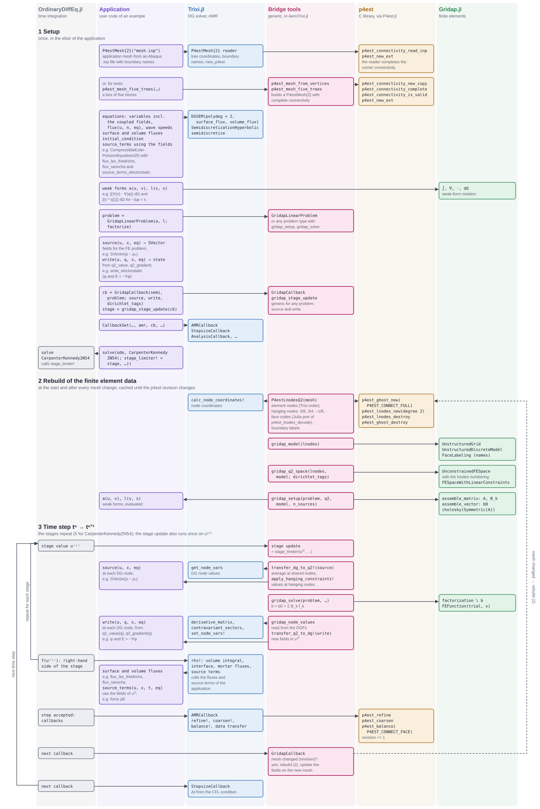
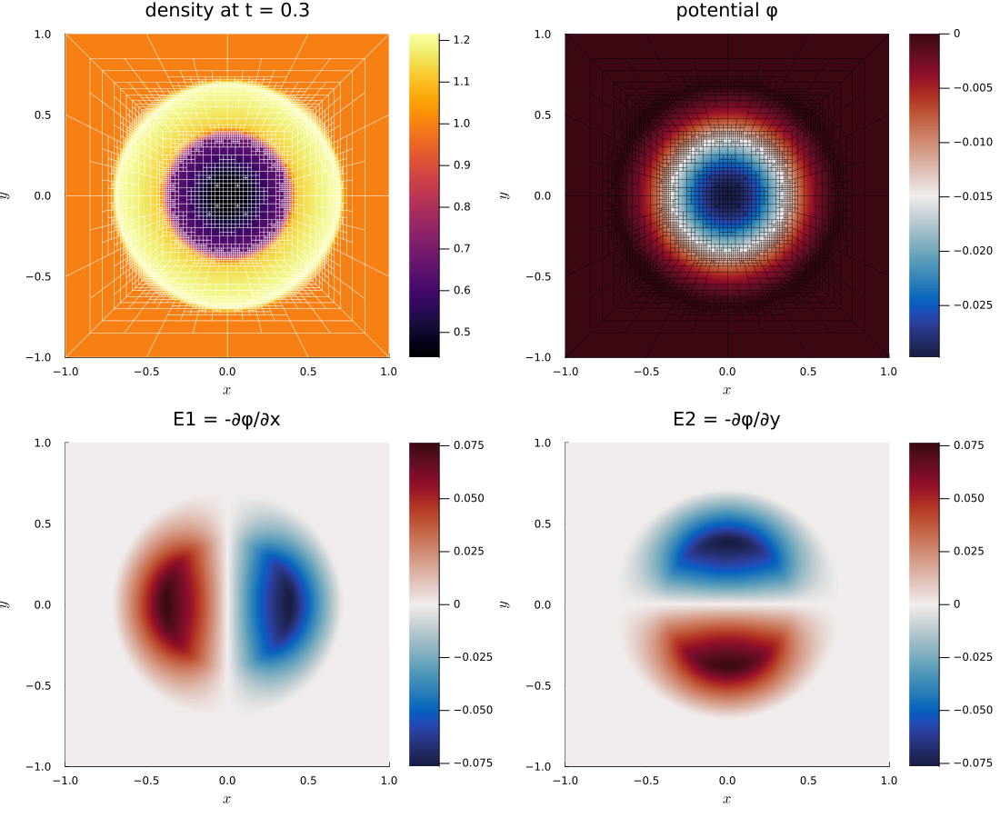

# Trixi.jl–Gridap.jl bridge

The bridge couples the discontinuous Galerkin (DG) solver of
[Trixi.jl](https://github.com/trixi-framework/Trixi.jl) with continuous finite elements of
[Gridap.jl](https://github.com/gridap/Gridap.jl) on the *same*, adaptively refined
`P4estMesh`. A typical use is a hyperbolic system that is coupled to an elliptic equation,
for example the Euler equations with an electrostatic potential: in each time step (or in
each Runge-Kutta stage), a source is taken from the DG solution, a finite element problem is
solved with Gridap.jl, and the result is written back into the DG solution, where it enters
the source terms of the flow.

Gridap.jl assembles the finite element problems from their weak form, so that other
problems than the Poisson problem of the example (systems, other operators, other boundary
conditions) can be set up with little effort. The bridge itself only provides the mesh, the
node numbering with hanging-node constraints, the data transfer, and a callback for the
time integration.

Current scope: 2D, `P4estMesh` with adaptive refinement, DG with polynomial degree 2,
continuous Q2 elements, serial runs.

## Overview: the flow of a run

The diagram follows a simulation from the setup through the rebuilds after mesh changes to
the Runge-Kutta stages of a time step. Each lane is one code base, time runs downward, and
an arrow means "calls or uses":

- **OrdinaryDiffEq.jl** (grey): the time integration, which calls the stage update of the
  bridge as `stage_limiter!` on each stage;
- **Application** (violet): what an example provides, i.e., the mesh (from an `.inp` file,
  or from vertices for tests), the equations with their fluxes and source terms, the weak
  forms of the finite element problem, and the pointwise `source` and `write` functions;
  the Euler-Poisson example serves as illustration;
- **Trixi.jl** (blue): the DG solver, the right-hand side, and the mesh adaptation;
- **Bridge tools** (pink): the generic parts of the bridge in AeroTrixi.jl;
- **p4est** (amber): the forest, its connectivity and adaptation, and the node numbering
  `p4est_lnodes`;
- **Gridap.jl** (green): the model, the finite element spaces, assembly, and solution.

[](assets/trixi_gridap_bridge_flow.svg)

The diagram is also available as a separate file,
[`docs/src/assets/trixi_gridap_bridge_flow.svg`](assets/trixi_gridap_bridge_flow.svg).

## Foundations

### Matching nodes: DG with `polydeg = 2` and Q2 elements

The DG solution of Trixi.jl with polynomial degree 2 lives at the 3 × 3 Legendre-Gauss-Lobatto
nodes of each element, which in reference coordinates are ``\{-1, 0, 1\}^2``. These are
exactly the nodes of the continuous Q2 Lagrange element on the same quadrilateral. Each DG
element is therefore one Q2 element, and all transfers between the two discretizations work
node by node, without interpolation or projection:

- **DG → Q2**: the value at a Q2 node is the *average* of the DG values of all elements that
  share the node. The values at hanging nodes are then set from the hanging-node
  constraints, so that the result is a continuous Q2 function.
- **Q2 → DG**: the Q2 value is *injected* at each DG node. Gradients are computed element by
  element with the derivative matrix and the metric terms of Trixi.jl; they are
  discontinuous across elements, as expected for the gradient of a continuous Q2 function.

### Continuous node numbering from `p4est_lnodes`

`p4est` creates a continuous node numbering of degree 2 for the forest of the `P4estMesh`
(`p4est_lnodes_new` with degree 2). [`P4estLnodesQ2`](@ref) turns it into the data needed on
both sides:

- `element_nodes`: the 9 nodes of each element, in the lexicographic order of the DG nodes
  of Trixi.jl (`i` fastest), so that DG node `(i, j)` of element `e` is
  `element_nodes[i + 3 * (j - 1), e]`;
- `coordinates` of all nodes;
- the hanging nodes with their constraints (see below); they are numbered after the
  `n_independent` independent nodes;
- boundary labels: the boundary names of the `P4estMesh` (as used by Trixi.jl for boundary
  conditions) are attached to the boundary nodes. Nodes on more than one named boundary
  (corners of the box) get their own entity with all names.

`p4est_lnodes` needs the full connectivity between the trees, including the *corners*.
Meshes from `.inp` files are complete (`p4est_connectivity_read_inp` completes the
connectivity). `P4estMesh(trees_per_dimension; ...)` of Trixi.jl does not contain the corner
connectivity; use [`p4est_mesh_from_vertices`](@ref), which completes the connectivity with
`p4est_connectivity_complete`, or the test mesh [`p4est_mesh_five_trees`](@ref) of the box
``[-1, 1]^2`` (a center square and four trapezoids, with bilinear trees).

### Hanging nodes

The `P4estMesh` of Trixi.jl is 2:1 balanced, so a coarse face meets at most two fine faces.
On a coarse face with the Q2 nodes ``a``, ``m`` (midpoint), ``b``, the fine faces carry the
nodes ``a, q_1, m, q_2, b``. The node at ``m`` is the coarse midpoint itself; the quarter
points are hanging nodes with the constraint of the quadratic interpolation on the coarse
face,
```math
u(q_1) = \tfrac{3}{8} u(a) + \tfrac{3}{4} u(m) - \tfrac{1}{8} u(b).
```
With 2:1 balance, the masters of a hanging node are never hanging themselves, so the
constraints are explicit. [`apply_hanging_constraints!`](@ref) sets the values of all hanging
nodes from their masters.

### Gridap.jl model and space

[`gridap_model`](@ref) creates a Gridap.jl `UnstructuredDiscreteModel` from the element
corners, with face labels `"interior"`, `"boundary"`, and the boundary names of the mesh.
(Gridap.jl would otherwise treat the faces at hanging nodes as boundary faces.)

[`gridap_q2_space`](@ref) creates the Q2 space with the node numbering of
[`P4estLnodesQ2`](@ref): an unconstrained space with all nodes as degrees of freedom, and
the space `FESpaceWithLinearConstraints` that eliminates the hanging nodes with their
constraints. Nodes with a boundary name in `dirichlet_tags` are Dirichlet nodes. Symmetric
problems stay symmetric after the elimination; the matrix of the Poisson problem with
Dirichlet conditions is symmetric positive definite and can be factorized with Cholesky.

## Interface

| Function | Purpose |
|---|---|
| [`p4est_mesh_from_vertices`](@ref), [`p4est_mesh_five_trees`](@ref) | `P4estMesh` with full face and corner connectivity |
| [`P4estLnodesQ2`](@ref) | continuous Q2 node numbering, hanging nodes, boundary labels |
| [`apply_hanging_constraints!`](@ref) | values at hanging nodes from their masters |
| [`gridap_model`](@ref), [`gridap_q2_space`](@ref) | Gridap.jl model and Q2 space (with constraints and Dirichlet nodes) |
| [`gridap_q2_function`](@ref), [`gridap_node_values`](@ref) | node values → Gridap.jl function and back |
| [`transfer_dg_to_q2!`](@ref) | DG solution → node values (averaging, constraints) |
| [`transfer_q2_to_dg!`](@ref), [`q2_value`](@ref), [`q2_gradient`](@ref) | node values → DG solution (injection, element-wise gradients) |
| [`GridapCallback`](@ref), [`gridap_stage_update`](@ref) | finite element solves during the time integration |
| [`GridapLinearProblem`](@ref), [`gridap_setup`](@ref), [`gridap_solve`](@ref) | finite element problems of the callback |
| [`CompressibleEulerPoissonEquations2D`](@ref), [`source_terms_electrostatic`](@ref), [`write_electrostatic`](@ref) | Euler equations with electrostatic potential |

The Gridap.jl parts are a package extension of AeroTrixi.jl, which is loaded together with
Gridap.jl. Load Gridap.jl with `import Gridap` and import only the names you need, e.g.,
`using Gridap: ∫, ∇, ⋅`; with `using Gridap`, names such as `solve` clash with Trixi.jl and
OrdinaryDiffEq.jl.

### User functions of the transfers

Both transfers take a pointwise user function, similar to initial conditions and source
terms in Trixi.jl:

- `source(u, x, equations)` returns an `SVector` of fields at a DG node, e.g.,
  `SVector(u[1] - ρ0)`; [`transfer_dg_to_q2!`](@ref) writes them into a matrix
  `n_fields × n_nodes`.
- `write(u, q, x, equations)` returns the new state at a DG node; `q2_value(q, k)` and
  `q2_gradient(q, k)` give the Q2 field `k` and its gradient at this node.
  [`transfer_q2_to_dg!`](@ref) writes the state directly into the DG solution vector.

For the Euler-Poisson equations, [`write_electrostatic`](@ref) keeps the Euler variables and
sets ``\phi`` and ``E = -\nabla\phi``; it is equivalent to
```julia
function write_electrostatic(u, q, x, equations::CompressibleEulerPoissonEquations2D)
    ∇φ = q2_gradient(q)
    return SVector(u[1], u[2], u[3], u[4], q2_value(q), -∇φ[1], -∇φ[2])
end
```

### Finite element problems

A [`GridapCallback`](@ref) solves a *problem*, which implements two functions:

- `gridap_setup(problem, q2, model, n_sources)`: mesh-dependent data (e.g., matrix and
  factorization), computed at the start and after each mesh change;
- `gridap_solve(problem, setup, q2, source_nodes)`: the solution for the source node values
  `source_nodes[k, node]`, as a Gridap.jl function (or a tuple of functions for several
  fields).

[`GridapLinearProblem`](@ref) covers linear problems ``a(u, v) = l(v)`` with homogeneous
Dirichlet conditions, given by their weak forms:
```julia
poisson = GridapLinearProblem((φ, v, dΩ) -> ∫(∇(v) ⋅ ∇(φ)) * dΩ,
                              (v, sources, dΩ) -> ∫(v * sources[1]) * dΩ;
                              factorize = A -> cholesky(Symmetric(A)))
```
After each mesh change, it assembles and factorizes the matrix. For a linear form that is
affine in the sources (the default `precompute_load = true`), it also assembles the matrices
``B_k`` with the load vector ``b = b_0 + \sum_k B_k f_k`` for the source values ``f_k`` at the
nodes, so that each solve only needs sparse matrix-vector products and the solve with the
factorization. Other linear forms need `precompute_load = false`; then the load vector is
assembled with Gridap.jl for each solve.

Other problems (e.g., systems or nonlinear problems) can be added by implementing
`AeroTrixi.gridap_setup` and `AeroTrixi.gridap_solve` for a new problem type.

### Time integration: callback and stage updates

```julia
callback = GridapCallback(semi, poisson; source, write = write_electrostatic,
                          dirichlet_tags = (:x_neg, :x_pos, :y_neg, :y_pos))
```
On its own, the callback solves the problem at the start and after every `interval` time
steps. The solution is then constant during the stages of a Runge-Kutta step, which limits
the coupled time integration to first order in time.

For the full order, the problem is solved on each Runge-Kutta stage. The SSPRK and
low-storage Runge-Kutta methods of OrdinaryDiffEq.jl call a `stage_limiter!` on each stage
value before the right-hand side is evaluated, and on the solution at the end of each step;
[`gridap_stage_update`](@ref) provides it:
```julia
stage_update = gridap_stage_update(callback)
sol = solve(ode, CarpenterKennedy2N54(; stage_limiter! = stage_update,
                                      williamson_condition = false); ...)
```
(With `williamson_condition = true`, the stage limiter is not called. In OrdinaryDiffEqCore.jl
v4, the stage limiter can also be passed to `solve` as the keyword `stage_limiter`.) The
callback then only acts at the start and after mesh changes, where it rebuilds the mesh data
and updates the solution on the new mesh. Mesh changes are detected with the revision counter
of `p4est`; in the `CallbackSet`, the `GridapCallback` must come after the `AMRCallback`.

The difference in accuracy, for the Euler-Poisson equations with coupling on a fixed mesh
(error of the Euler variables against a reference with a much smaller time step):

| time steps | update per step | update per stage |
|---|---|---|
| 10 | 3.4e-4 | 1.6e-6 |
| 20 | 1.7e-4 | 1.0e-7 |
| 40 | 8.9e-5 | 6.9e-9 |
| 80 | 4.5e-5 | 5.8e-10 |
| order | 1 | 4 |

## Example: Euler-Poisson blast wave

The example
[`elixir_euler_poisson_blast_five_trees_amr.jl`](https://github.com/ACoM-RWTH/AeroTrixi.jl/blob/main/examples/p4est_2d_dgsem/elixir_euler_poisson_blast_five_trees_amr.jl)
combines all parts:

- [`CompressibleEulerPoissonEquations2D`](@ref) with the variables
  ``(\rho, \rho v_1, \rho v_2, \rho e, \phi, E_1, E_2)``; the potential and the field have no
  flux in the DG discretization, they are only set by the bridge. The force of the field on
  the flow, [`source_terms_electrostatic`](@ref), is scaled by `coupling`, which is zero in
  the example: the potential follows the density but does not act on the flow yet.
- A pressure blast (pressure 2 inside the radius 0.3, 1 outside, constant density) on the
  five-tree mesh of ``[-1, 1]^2``, DG with `polydeg = 2`, shock capturing, and adaptive mesh
  refinement between the levels 1 and 5.
- The Poisson problem ``-\Delta\phi = \rho - \rho_0`` with ``\phi = 0`` on the boundary,
  solved on each Runge-Kutta stage, with the field ``E = -\nabla\phi``.

Run it with
```julia
using Trixi, AeroTrixi
trixi_include(joinpath(AeroTrixi.examples_dir(), "p4est_2d_dgsem",
                       "elixir_euler_poisson_blast_five_trees_amr.jl"))
```
and plot the density with the mesh, the potential, and the field with Plots.jl:
```julia
using Plots
pd = PlotData2D(sol)
p1 = plot(pd["rho"], title = "density at t = $(sol.t[end])")
plot!(p1, getmesh(pd), linecolor = :white, linewidth = 0.3)
p2 = plot(pd["phi"], title = "potential φ", color = :balance)
plot!(p2, getmesh(pd), linecolor = :black, linewidth = 0.2)
p3 = plot(pd["E1"], title = "E1 = -∂φ/∂x", color = :balance)
p4 = plot(pd["E2"], title = "E2 = -∂φ/∂y", color = :balance)
plot(p1, p2, p3, p4, layout = (2, 2), size = (1100, 900))
```



### Performance

All timings: Julia 1.13, one thread, after compilation (a short run first).

**Example run.** 336 time steps up to `t = 0.3`, about 3000–4300 cells
(4262 at the end), mesh adaptation every 20 steps; 18.2 s in total:

| part | calls | time | per call |
|---|---|---|---|
| Trixi.jl right-hand side | 1680 | 8.6 s | 5.1 ms |
| Gridap.jl stage updates (DG → Q2, solve, Q2 → DG) | 1680 | 4.8 s | 2.9 ms |
| Gridap.jl rebuilds after mesh changes (incl. first) | 17 | 2.8 s | 162 ms |
| mesh adaptation (Trixi.jl) | 16 | 0.9 s | 53 ms |

A stage update costs about half of a right-hand side evaluation of Trixi.jl; its main part
is the solve with the Cholesky factorization. A rebuild (node numbering, Gridap.jl model
and space, assembly and factorization of the matrix, load matrices) costs about as much as
one time step.

**Costs per call** in ms, on the five-tree mesh at the uniform levels 1 to 5 with one more
refined ring (hanging nodes):

| cells | Q2 nodes | rebuild | stage update: DG → Q2 / load + solve / Q2 → DG | Trixi.jl rhs |
|---|---|---|---|---|
| 773 | 3197 | 29 | 0.51: 0.03 / 0.39 / 0.08 | 0.75 |
| 3029 | 12319 | 94 | 2.35: 0.20 / 1.82 / 0.34 | 2.95 |
| 11975 | 48301 | 433 | 8.3: 0.60 / 6.4 / 1.3 | 10.9 |
| 47777 | 191909 | 1830 | 61: 4.7 / 48 / 8.1 | 65 |

The transfers are a small part of a stage update. In a rebuild, the node numbering and the
Gridap.jl model and space take less than 10%; most of the time is spent in the assembly
and factorization of the matrix and in the load matrices. The load matrices pay off
after 6–11 solves (1–2 time steps with stage updates), compared with assembling the load
vector for each solve.

**Adaptation interval and refinement.** Since each mesh change also rebuilds the finite
element data, the interval of the mesh adaptation matters. For the example (wall times
of the whole run without the analysis and output callbacks; L1 error of the density at `t = 0.3` against a uniform run at the finest
level 5 with 20480 cells):

| AMR interval | AMR thresholds | mean cells | time | rebuilds | L1 error |
|---|---|---|---|---|---|
| 5 | 0.06 / 0.2 | 2722 | 19.8 s | 67 | 1.75e-2 |
| 20 | 0.06 / 0.2 | 2858 | 14.2 s | 17 | 2.02e-2 |
| 5 | 0.015 / 0.05 | 3381 | 23.5 s | 67 | 7.1e-3 |
| 20 | 0.015 / 0.05 | 3483 | 16.2 s | 17 | 5.9e-3 |
| 40 | 0.015 / 0.05 | 3430 | 14.4 s | 9 | 1.2e-2 |

Lower thresholds refine a wider region around the shock. With them, the mesh can be adapted
less often without losing the shock, which reduces the rebuilds; beyond about 20 steps,
the shock leaves the refined region between two adaptations. The example uses the interval
20 with the lower thresholds. For comparison, the uniform run at level 5 (Euler equations
only, without the Poisson problem) takes 38.6 s.

## Limitations and outlook

- 2D, DG with `polydeg = 2` and Q2 elements, serial runs only.
- [`GridapLinearProblem`](@ref) has homogeneous Dirichlet conditions; other boundary
  conditions, systems, or nonlinear problems need their own problem type with
  [`gridap_setup`](@ref) and [`gridap_solve`](@ref).
- The stage updates require a time integration method with `stage_limiter!` (SSPRK and
  low-storage methods of OrdinaryDiffEq.jl).
